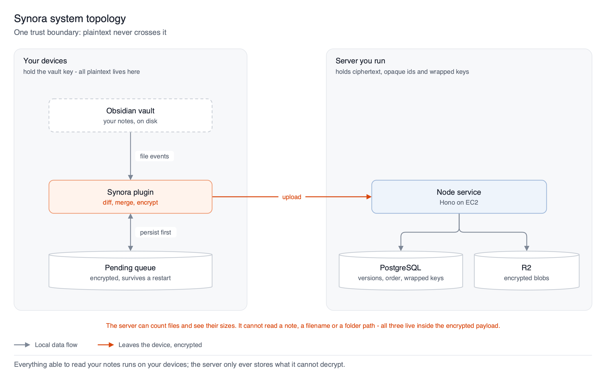
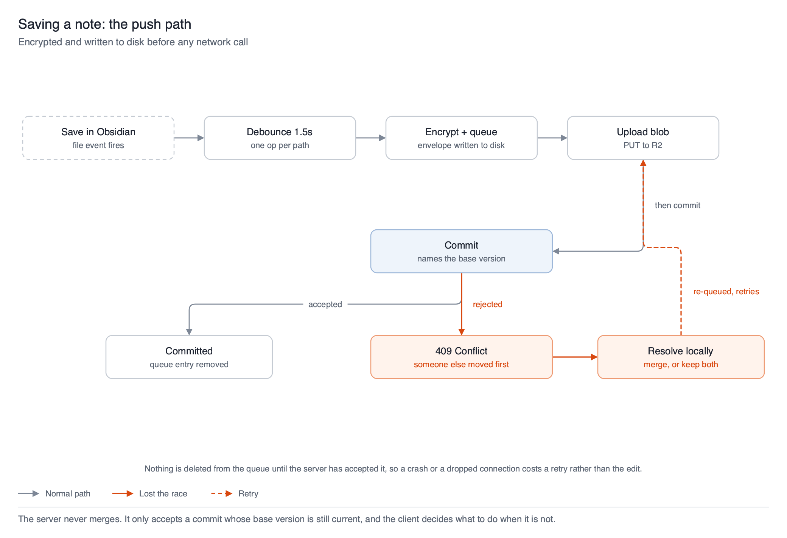
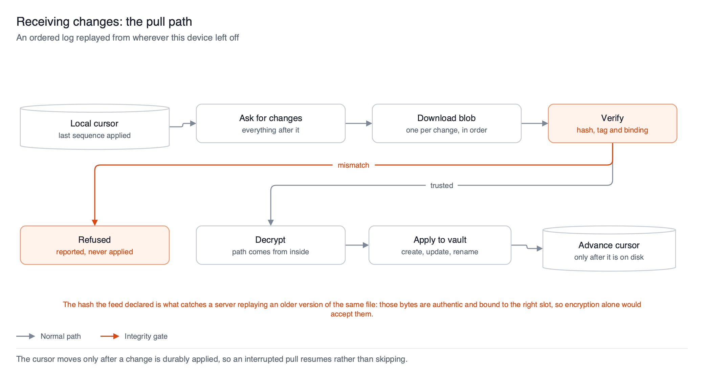
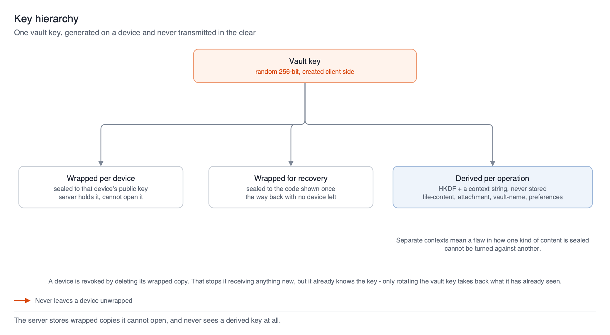

# How Synora works

A functional tour of the running system: what the pieces are, what
happens on a save, what happens on a sync, and how conflicts, keys and
storage are handled.

This is the *what happens* document. Its companions:

| Document | Answers |
|---|---|
| [`architecture.md`](./architecture.md) | **Why** it is built this way — constraints, rejected alternatives, production failures |
| [`protocol-spec.md`](./protocol-spec.md) | The exact wire contract — formats, envelopes, endpoints |
| [`deploy-ec2.md`](./deploy-ec2.md) | How to stand one up |

---

## 1. The shape of it

Synora keeps an Obsidian vault in sync across devices without the server
being able to read anything in it.



There is exactly one trust boundary. On your side of it live the notes,
the vault key, and every piece of logic that understands content:
diffing, merging, conflict resolution, encryption. On the far side lives
a Node service that authenticates callers, puts changes in a total
order, and stores bytes.

That split is not an implementation detail — it is the whole design. The
server **cannot** merge, search, deduplicate or repair anything, because
it cannot see content. Everything a server would normally do, the client
does instead.

**What the server can see:** how many files exist, how large they are,
when they changed, and opaque ids.
**What it cannot see:** note content, file names, folder paths. All
three live *inside* the encrypted payload.

## 2. What the server stores

Three concepts, all content-blind.

| | What it is | Why |
|---|---|---|
| **File** | An opaque, stable id | Survives renames. The server has no path column, so identity *cannot* be the path |
| **Version** | Immutable row: blob pointer, hash, size | Immutability makes the concurrency check trivial and rollback detectable |
| **Change event** | Append-only entry with a per-vault sequence number | Gives every device one total order to replay |

Plus a **cursor** per device — the highest sequence it has applied.
That number is the entire read-side state machine.

The blob itself sits in R2. The database only holds a pointer to it.

## 3. Saving a note



A save is **encrypted and written to local disk before any network call
happens**. That ordering is the durability guarantee: once an edit is in
the pending queue it survives Obsidian closing, a crash, or being offline
for a week.

Then two steps against the server: upload the blob, then commit metadata
naming the version the edit was based on.

**The commit is the one place correctness is absolute.** In a single
transaction, holding a per-vault lock, the server:

1. returns the original result if this idempotency key was already used
   — so a retry after a dropped response can't double-commit
2. verifies the blob exists and its size and hash match what was declared
3. **verifies the file is still on the base version the client named**
4. allocates the sequence number and writes the version and change event

Step 3 is optimistic concurrency and it is the load-bearing wall. The
server never overwrites a newer version with an older one, and never
guesses at a merge. A client that lost the race is told so and must
reconcile.

Note the ordering of 1 and 3: idempotency is checked **first**. A retry
sent after a `200` was lost in transit carries a base version the first
attempt already superseded, so checking the base first would reject a
commit that in fact succeeded.

## 4. Receiving changes



A device asks for everything after its cursor and replays it in order.
Each change is downloaded, **verified, then applied** — and the cursor
only moves after the change is durably on disk, so an interrupted pull
resumes rather than skipping.

Verification is three independent checks, and they catch different
things:

- **the authentication tag** — the bytes were altered
- **the bound metadata** — a blob was replayed into a *different* file's slot
- **the hash the feed declared** — an *older version of this same file*
  was served as the current one

Only the third catches a rollback. Those bytes are genuinely yours,
correctly signed and correctly bound; nothing but the declared hash
distinguishes them from the current version.

Renames carry no special machinery. The path lives inside the encrypted
payload, so a rename is just a new version of the same file id — the
receiving device notices the path changed and moves its local copy.

## 5. When two devices disagree

The server detects conflicts; the client resolves them. Always.

| Situation | Resolution |
|---|---|
| One side changed | Apply it |
| Both changed, non-overlapping text | Three-way merge, committed naming both parents |
| Both changed, overlapping | Keep both — a conflict copy beside the original |
| Any binary file | Keep both — never merged |
| **Delete vs. unsynced edit** | **The edit wins — the file is restored** |
| Both sides deleted | Accept it |
| Merge logic unsure for any reason | Keep both |

The asymmetry is deliberate throughout: **a spurious conflict copy is a
minor annoyance; a bad merge is lost writing.** The merge falls back
aggressively.

Delete-versus-edit deserves its own note, because the obvious
implementation is wrong in a way that looks right. A tombstone carries
an *empty* payload, so feeding it to the three-way merge means merging
real text against nothing — producing an empty file over the note, with
the actual writing pushed into a conflict copy. Instead the delete loses
outright: the edit is re-committed on top of the tombstone and the file
comes back. Re-deleting takes a second; unsynced writing is gone for
good.

## 6. Keys, devices and recovery



One vault key is generated on the device that creates the vault. It is
never transmitted in the clear. The server only ever holds **wrapped**
copies — one sealed to each device's public key, one sealed to the
recovery code shown once at creation.

Adding a device means getting the vault key wrapped for it, either by an
already-trusted device approving it or by using the recovery code.

Every encryption operation derives its own key from the vault key via
HKDF with a context string (`file-content`, `attachment`, `vault-name`,
`preferences-bundle`). The separation means a flaw in how one kind of
content is sealed cannot be combined with ciphertext of another.

Account login is argon2id plus bearer tokens — deliberately boring, and
separate from all of the above. Defeating it gets someone encrypted
blobs they still cannot read.

**Revocation is partial and honestly so.** Deleting a device's wrapped
copy stops it receiving anything new, but it already knows the key. Only
rotating the vault key takes back what it has already seen, and that is
not implemented yet.

## 7. Reclaiming storage

Every save writes a whole new encrypted copy; nothing overwrites. Left
alone, usage only climbs — and deleting a file makes it worse, because
the tombstone is itself a commit with a blob.

A job runs daily to collect what is provably unreachable. It is the only
code in the system that deletes user data, so it is narrow by design. A
version is removed only when **all** of these hold:

1. it is not its file's current version
2. it is older than the retention window (30 days)
3. every non-revoked device has already acked past it
4. a newer event exists for the same file that every device has *also*
   acked

Rule 4 is stronger than it first appears, for two separate reasons. A
device that has never synced rebuilds the whole vault by replaying the
feed from zero, so a file's newest event is load-bearing — drop it and
that file silently ceases to exist for every future device. And the
version sitting at a device's cursor is the base its pending edits merge
against; collect it and that file's next conflict degrades into a
conflict copy.

The practical cost: **a vault with one permanently offline device
reclaims nothing**, because its cursor pins everything. That is the
intended trade. Stalled reclamation is recoverable; deleting a version
someone still needs is not.

## 8. Preferences

Separate from file sync, and deliberately simpler. One device is the
vault's **primary**, and can push a bundle of its Obsidian preferences —
theme, community plugins, hotkeys, snippets. Other devices are offered
it explicitly and never have it applied automatically.

There is no merge and no history: pushing replaces the whole bundle.
Two things are excluded by construction — `workspace.json`, which is
per-device by nature, and Synora's own plugin folder, which holds that
device's secret key and access token. Copying the latter would overwrite
a device's identity with another's and corrupt both.

## 9. What runs where

The backend is an ordinary Node process: a Hono app behind TLS, a
long-lived Postgres pool, and R2 reached over its S3-compatible API.
Cloudflare is used for object storage and nothing else.

```
server.ts    entrypoint: config, pool, bucket, cron, graceful shutdown
app.ts       the Hono app
context.ts   AppBindings — the seam that keeps routes runtime-agnostic
routes/      auth, vaults, sync, account
auth/        argon2id, JWTs, rate limiting
db/          schema and client
storage/     the four-method blob interface, and its R2 implementation
gc.ts        storage reclamation
```

`context.ts` is worth understanding before changing anything. Every
route takes its database, bucket and secrets from an explicit bindings
object rather than reaching for globals. That is why the whole backend
moved off Cloudflare Workers without a single route changing, and why
the tests can run the real app against an in-memory bucket. A route that
imports a database directly would weld the app to one runtime and take
the tests' seam with it.
